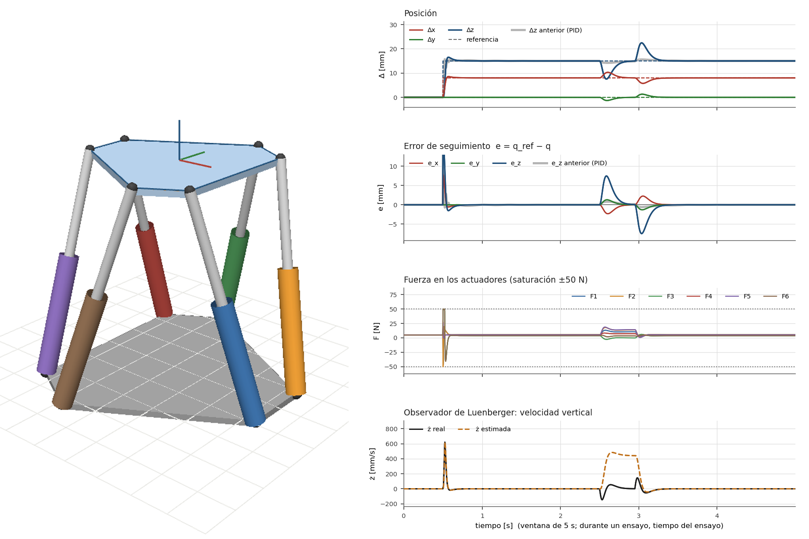
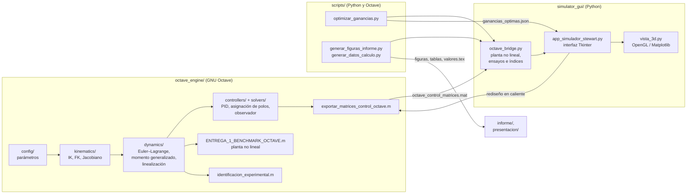

# Modelado, identificación y control de una plataforma Stewart 6-SPS

Gemelo digital de una plataforma Stewart de seis actuadores lineales, modelada por el método del momento generalizado, con la **fuerza axial de cada actuador como entrada**. El objetivo general del proyecto es diseñar, analizar, implementar y comparar estrategias clásicas, modernas y óptimas de control para la posición y la orientación de una plataforma Stewart 6-SPS. Esta **primera entrega** aborda las dos primeras estrategias: un **PID descentralizado** en el espacio articular y una **realimentación de estados con acción integral y observador de Luenberger**. Los parámetros de ambas se obtienen por **optimización numérica** de un criterio común, y cada óptimo se verifica como mínimo local.

El motor matemático (modelado, linealización, diseño de controladores, identificación y banco de pruebas no lineal) está escrito en **GNU Octave**, sin toolboxes. La interfaz de simulación interactiva está escrita en **Python** (Tkinter, Matplotlib y OpenGL).

Proyecto del curso *Estrategias Óptimas de Control*, Maestría en Ingeniería Electrónica, Escuela Colombiana de Ingeniería Julio Garavito.



---

## Contenido

- [Resultados principales](#resultados-principales)
- [Arquitectura](#arquitectura)
- [Instalación](#instalación)
- [Simulador interactivo](#simulador-interactivo)
- [Modelo de la planta](#modelo-de-la-planta)
- [Estrategias de control](#estrategias-de-control)
- [Cálculo de los parámetros óptimos](#cálculo-de-los-parámetros-óptimos)
- [Índices de desempeño (Tabla 1)](#índices-de-desempeño-tabla-1)
- [Flujo de trabajo reproducible](#flujo-de-trabajo-reproducible)
- [Pruebas automáticas](#pruebas-automáticas)
- [Estructura del repositorio](#estructura-del-repositorio)
- [Autor](#autor)

---

## Resultados principales

| Estrategia | Parámetros óptimos | Criterio $J$ (diseño → óptimo) | RMS pose [mm / °] | ITAE | $J_u$ [N²·s] | Robustez (±20 % $B_d$) |
|---|---|---|---|---|---|---|
| PID descentralizado | $K_p = 4556.7$ N/m, $K_i = 18445.7$ N/(m·s), $K_d = 105.43$ N·s/m | 6.25 → **4.777** | 2.292 / 0.119 | 0.0484 | 1906.6 | +29.5 % |
| Realimentación de estados | polos del controlador ×3.357, observador ×0.3525 | 6.25 → **3.633** | 1.955 / 0.306 | 0.0473 | 1141.2 | +23.0 % |

Error RMS de posición [mm] en las referencias del simulador (parámetros óptimos, ruido de 0.1 mm):

| Referencia | PID | Realimentación de estados |
|---|---|---|
| Senoidal en $z$ (±15 mm) | 0.12 | 0.12 |
| Maniobra acoplada de 6 GDL | 1.42 | 0.50 |
| Trayectoria circular | 1.74 | 0.69 |
| Casos de frontera A–D (onda en $z$) | 0.10 | 0.07 |
| Maniobras variacionales y de tiempo mínimo | 0.31–0.33 | 0.08–0.09 |

Otras propiedades verificadas:

- **Modelo:** controlable y observable, e **inestable en lazo abierto** (polos en ±7.62, ±6.43, ±4.11 y ±2.40 s⁻¹) por la rigidez geométrica negativa de las patas con precarga. La identificación MIMO en lazo cerrado sobre la planta no lineal, con ruido de medición de 0.05 mm en las longitudes y un ensayo de validación independiente, muestra que el ARX directo a 2 ms queda sesgado por el ruido (masas de 0.10 a 0.14 kg); con prefiltro de 20 Hz y diezmado a 10 ms, el ARX(2,2) da masas de 0.835 a 0.900 kg (modelo: 0.805 kg) y FIT = 84.8 % en predicción a 0.1 s, igual que el modelo analítico con el mismo procedimiento (84.7 %).
- **PID óptimo:** cumple la condición de Routh $K_p > k + mK_i/K_d$; lazo de una pata con las demás cerradas con margen de fase de 41.6°, margen de ganancia de 11.1 dB y $M_s = 2.15$; radio espectral del lazo MIMO de 0.9945.
- **Realimentación de estados:** $N_r$ verificado por cofactores, principio de separación verificado y observador en forma de estimador actual con sus polos implementados iguales a los diseñados.

---

## Arquitectura



- **Octave** produce el modelo y las matrices de diseño ($\mathbf A_d$, $\mathbf B_d$, $\mathbf K$, $\mathbf K_i$, $\mathbf N_r$, $\mathbf L_d$, ganancias PID) y ejecuta el banco de pruebas sobre la planta no lineal completa.
- **Python** carga esas matrices y simula en tiempo real ($T_s = 2$ ms) la planta no lineal (`planta_no_lineal.py`, la misma dinámica de Octave; los controladores y el observador usan el modelo linealizado), con saturación de la fuerza de las patas (±50 N), topes mecánicos y ruido de sensor.
- **Rediseño en caliente:** cuando se cambian los polos en la interfaz, se invoca a Octave para recalcular $\mathbf K$, $\mathbf K_i$, $\mathbf L$ y $\mathbf N_r$. El resultado se escribe en un archivo de sesión temporal, de modo que el óptimo guardado en `results/` no se modifica.

---

## Instalación

### Requisitos

| Componente | Versión | Uso |
|---|---|---|
| GNU Octave | ≥ 7 (probado en 11.1) | motor matemático; debe estar en el `PATH` como `octave` |
| Python | ≥ 3.10 (probado en 3.14), con Tkinter | interfaz y optimización |
| numpy, scipy, matplotlib | ver `requirements.txt` | cálculo y gráficas |
| PyOpenGL, pyopengltk | opcional | vista 3D acelerada; sin ellos se usa Matplotlib |
| LaTeX (pdflatex, latexmk) | opcional | compilar el informe y la presentación |

### Pasos

```bash
git clone <url-del-repositorio>
```

```bash
cd proyecto_final
```

```bash
python3 -m venv .venv
```

```bash
.venv/bin/pip install -r requirements.txt
```

En Debian/Ubuntu, Tkinter y Octave se instalan con:

```bash
sudo apt install python3-tk octave
```

En Windows, ejecutar `python simulator_gui/app_simulador_stewart.py` con Octave en el `PATH`. El lanzador `run_simulador.sh` es para Linux y macOS.

---

## Simulador interactivo

```bash
./run_simulador.sh
```

El lanzador busca primero un entorno virtual `.venv` en el proyecto, luego en la carpeta superior, y si no encuentra ninguno usa el `python3` del sistema. Variables de entorno útiles:

| Variable | Efecto |
|---|---|
| `STEWART_NO_GL=1` | fuerza la vista 3D con Matplotlib (equipos sin OpenGL) |
| `PYOPENGL_PLATFORM=glx` | selecciona el *backend* GLX en Linux con Wayland o XWayland si la vista OpenGL no abre |

### Panel de control

| Pestaña | Función |
|---|---|
| **Controlador** | Selección de la estrategia (PID o realimentación de estados). Arranca con las ganancias óptimas. $K_p$, $K_i$, $K_d$ y los factores de velocidad de los polos del controlador y del observador se pueden modificar con deslizador o campo numérico (Enter); **Restablecer ganancias óptimas** vuelve al óptimo del PID, **Rediseñar** recalcula las matrices de la realimentación de estados en Octave y **Matrices** muestra las vigentes. Con una trayectoria seleccionada, al cambiar de estrategia la trayectoria se repite desde su comienzo con el nuevo controlador. |
| **Referencia** | Posición y orientación deseadas $(\Delta x, \Delta y, \Delta z, \phi, \theta, \psi)$, o un generador de trayectoria: senoidal en $z$, maniobra acoplada de 6 GDL, circular, uno de los **cuatro casos de frontera** (A: inicio y final conocidos; B: inicio conocido, final libre; C: inicio libre, final conocido; D: ambos libres) aplicados a una onda en $z$, o una **trayectoria óptima** de maniobra (ida y vuelta periódica hacia la pose de los deslizadores): variacional de extremos fijos (Beltrami), de curva terminal (intercepción de la senoidal) o de tiempo mínimo (bang-bang de Pontryagin). Al elegir una referencia, la planta vuelve a la pose nominal y la trayectoria empieza desde su comienzo, de modo que cada caso se ve completo. |
| **Perturbaciones** | Fuerza $[F_x, F_y, F_z]$ (±1000 / ±1000 / ±2000 N), momento $[M_x, M_y, M_z]$ (±100 N·m), carga adicional $\Delta m$ (0–50 kg), ruido del sensor $\sigma$ (0–5 mm) e impulso (0–5000 N durante 0.45 s). Cada valor tiene deslizador y campo numérico; se admiten valores fuera del rango inicial y el deslizador se amplía. **Aplicar fuerza y carga** aplica los valores a la planta; **Anular** retira todas las perturbaciones (fuerza, momento, carga, impulso en curso y ruido). |

### Ensayo normalizado

Parte del equilibrio, aplica un escalón de referencia ($\Delta x = 8$ mm, $\Delta z = 15$ mm) en $t = 0.5$ s y un impulso de 20 N en $t = 2.5$ s, y termina a los 5 s. Al terminar, la simulación continúa sin pausa. Las gráficas se dibujan en tiempo de ensayo, con el ensayo anterior en gris para comparar.

Las gráficas muestran la pose y su referencia, el error de seguimiento, las fuerzas de los seis actuadores y la velocidad estimada por el observador frente a la real. El recuadro *Índices de desempeño* calcula en vivo los índices de la Tabla 1. El botón **Tabla 1** ejecuta el ensayo con ambas estrategias y permite copiar las filas en LaTeX o exportarlas a CSV.

### Atajos de teclado

| Tecla | Acción |
|---|---|
| `E` | ejecutar el ensayo normalizado |
| `Espacio` | pausar o continuar |
| `R` | reiniciar la planta |
| `I` | aplicar el impulso |
| `M` | reiniciar los índices |

En la vista 3D: arrastrar rota, la rueda hace zoom y el doble clic vuelve a la vista inicial.

---

## Modelo de la planta

El desarrollo completo, paso a paso, está en `desarrollo_matematico/desarrollo_matematico.pdf`; el informe (`informe/informe.pdf`) lo resume.

**Cinemática.** Pose $\mathbf q = [x\ y\ z\ \phi\ \theta\ \psi]^\top$ con rotación $\mathbf R = \mathbf R_z(\psi)\mathbf R_y(\theta)\mathbf R_x(\phi)$. La cinemática inversa es cerrada, $l_i = \lVert\mathbf p + \mathbf R\mathbf s_i - \mathbf b_i\rVert$. El Jacobiano es $\dot{\mathbf l} = \mathbf J\boldsymbol\nu$, con $\mathbf J_i = [\mathbf n_i^\top\ \ (\mathbf R\mathbf s_i\times\mathbf n_i)^\top]$. En el espacio de trabajo, $\kappa(\mathbf J) \le 27.4$.

**Entrada.** La entrada de cada actuador es la fuerza axial $F_i$ ($|F_i| \le 50$ N); por trabajo virtual, su fuerza generalizada es $(\mathbf J\mathbf T)^\top\mathbf F$. No se modela el accionamiento interno.

**Dinámica.** Las ecuaciones de movimiento se deducen del principio de Hamilton (Euler–Lagrange) y se construyen con el método del momento generalizado: plataforma, y por pata un cilindro (centro de masa a $b_C$ de $B_i$) y un pistón (a $b_S$ de $P_i$) como cuerpos rígidos. Cada cuerpo con velocidad $\mathbf u_c = \mathbf J_c\boldsymbol\nu$ aporta $\mathbf J_c^\top\tfrac{d}{dt}(\mathbf I_c\mathbf J_c\mathbf T\dot{\mathbf q})$:

$$\mathbf M(\mathbf q)\ddot{\mathbf q} + \mathbf C(\mathbf q,\dot{\mathbf q})\dot{\mathbf q} + \mathbf g(\mathbf q) = (\mathbf J\mathbf T)^\top\mathbf F + \boldsymbol\tau_d,\qquad \mathbf M = \mathbf T^\top\Big(\sum_c\mathbf J_c^\top\mathbf I_c\mathbf J_c\Big)\mathbf T$$

El modelo se verifica con `octave_engine/dynamics/validar_modelo_dinamico.m`: simetría y definición positiva de $\mathbf M$, conservación de la energía cinética en movimiento libre (deriva de $3\times10^{-13}$), gravedad igual al gradiente numérico de la energía potencial y dinámica inversa de la plataforma en una maniobra de prueba.

**Espacio de estados.** Estado $\mathbf x = [\mathbf q^\top\ \dot{\mathbf q}^\top]^\top \in \mathbb R^{12}$, entrada $\mathbf F \in \mathbb R^6$ y salida $\mathbf y = \mathbf q$. La linealización en la pose nominal ($F_0 = 4.779$ N por pata) da

$$\mathbf A = \begin{bmatrix}\mathbf 0 & \mathbf I\\ \mathbf A_{21} & \mathbf 0\end{bmatrix},\quad \mathbf B = \begin{bmatrix}\mathbf 0\\ \mathbf M_0^{-1}\mathbf J_0^\top\end{bmatrix},\quad \mathbf A_{21} = \mathbf M_0^{-1}\frac{\partial[(\mathbf J\mathbf T)^\top\mathbf F_0 - \mathbf g]}{\partial\mathbf q}$$

Con fuerzas constantes, cada pata aporta una rigidez negativa $-\tfrac{F_0}{l}(\mathbf I - \hat{\mathbf l}\hat{\mathbf l}^\top)$ (como una columna comprimida), y $\mathbf A$ tiene seis polos inestables ($\lambda = \pm\sqrt{\mu(\mathbf A_{21})}$). En las coordenadas de las patas la rigidez desestabilizadora llega a 428 N/m, de modo que toda ganancia proporcional por pata debe superarla. La discretización es exacta con retenedor de orden cero ($T_s = 2$ ms), mediante la exponencial por bloques de Van Loan.

**Cálculo de variaciones y control óptimo** (`simulator_gui/trayectorias_variacionales.py`). La primera variación con extremos libres, $\delta\mathcal J = F_{\dot x}\eta|_{t_f} - F_{\dot x}\eta|_{t_0} + \int(F_x - \tfrac{d}{dt}F_{\dot x})\eta\,dt$, da los **cuatro casos de frontera** (cada extremo conocido, $\eta = 0$, o libre, $F_{\dot x} = 0$). Se aplican al seguimiento suave de una onda en $z$, $r(t) = 15\cos(2\pi\cdot0.2\,t)$ mm durante medio periodo ($T = 2.5$ s, $a = 2$ s⁻¹), con $F = \tfrac12\dot x^2 + \tfrac12a^2(x - r(t))^2$ y solución $x = \kappa r + C_1e^{-at} + C_2e^{-a(T - t)}$:

| Caso | Límite inferior | Límite superior | Condiciones |
|---|---|---|---|
| A | conocido | conocido | $x(0) = 0$, $x(T) = 0$ |
| B | conocido | libre | $x(0) = 0$, $\dot x(T) = 0$ |
| C | libre | conocido | $\dot x(0) = 0$, $x(T) = 0$ |
| D | libre | libre | $\dot x(0) = 0$, $\dot x(T) = 0$ |

Con el error normalizado $\varepsilon$ de una maniobra y $F = \tfrac12\dot\varepsilon^2 + \tfrac12a^2\varepsilon^2$ se obtienen además:

| Caso | Condición | Trayectoria |
|---|---|---|
| III (Beltrami), extremos fijos | $\tfrac12\dot\varepsilon^2 - \tfrac12a^2\varepsilon^2 = C$ | $\sinh(a(T - t))/\sinh(aT)$ |
| Estado final libre | $F_{\dot\varepsilon}(T) = 0$ | $\cosh(a(T - t))/\cosh(aT)$ |
| II, descuento $e^{-\alpha t}$ | $\ddot\varepsilon - \alpha\dot\varepsilon - a^2\varepsilon = 0$ | $C_1e^{r_1t} + C_2e^{r_2t}$ |
| Tiempo final libre | $\mathcal H(T) = 0$ | $\dot\varepsilon = -a\varepsilon$ |
| Curva terminal + caso I | $[F + F_{\dot z}(\dot\phi - \dot z)]_T = 0$ | recta con $\dot z = 2\dot\phi(T)$ |
| Multivariable | $\mathbf M_0\ddot{\mathbf e} = \mathbf K\mathbf e$, Legendre $\mathbf M_0\succ 0$ | modos $\omega \approx 2$ s⁻¹ |
| Pontryagin, tiempo mínimo (doble integrador) | $\ddot l^\star = -\ddot l_{\max}\,\mathrm{sign}(\lambda_2)$ | bang-bang con una conmutación en $T/2$ |

El mínimo se certifica con la condición de Legendre, la convexidad de $F$ y el método de Ritz. Con Pontryagin se obtienen además la maniobra de mínima energía de una pata (control lineal en el tiempo) y la de tiempo mínimo con aceleración acotada (1.08 s para la pata más exigida).

**Planta no lineal de referencia** (banco de pruebas): modelo dinámico completo (12 estados) integrado con RK4, fuerza saturada a ±50 N y registro de la carrera, la holgura entre patas y la inclinación de las rótulas.

---

## Estrategias de control

### PID descentralizado (espacio articular)

Un PID por pata sobre el error de longitud $e_i = l_{i,r} - l_i$, con referencias obtenidas por cinemática inversa:

$$F_i(k) = F_0 + K_p e_i(k) + K_i x_{I,i}(k) + K_d d_i(k),\qquad d_i(k) = \alpha\,d_i(k-1) + (1 - \alpha)\frac{e_i(k) - e_i(k-1)}{T_s},\quad \alpha = e^{-160\,T_s}$$

Usa integración condicional como anti-*windup*. Con el modelo de una pata $1/(ms^2 - k)$, el criterio de Routh exige $K_d > 0$ y $K_p > k + mK_i/K_d$. La estabilidad se verifica en el lazo MIMO completo (30 estados).

### Realimentación de estados con acción integral y observador

$$\delta\mathbf u = -\mathbf K\hat{\mathbf x} + \mathbf K_i\mathbf z + \mathbf N_r\delta\mathbf r,\qquad \dot{\mathbf z} = \mathbf r - \mathbf C\delta\mathbf x,\qquad \mathbf N_r = -\big[\mathbf C(\mathbf A - \mathbf B\mathbf K)^{-1}\mathbf B\big]^{-1}$$

- **Asignación de los 18 polos** del sistema aumentado mediante la ecuación de autovectores, $\mathbf v_j = (\mathbf A_a - \lambda_j\mathbf I)^{-1}\mathbf B_a\mathbf g_j$ y $\mathbf K_a\mathbf V = \mathbf G \Rightarrow \mathbf K_a = \mathbf G\mathbf V^{-1}$, en `solvers/octave_place_mimo.m`.
- **Observador de Luenberger discreto** en forma de estimador actual. Su error de predicción evoluciona con $\mathbf A_d(\mathbf I - \mathbf L_d\mathbf C_d)$, que tiene los mismos valores propios que $\mathbf A_d - \mathbf L_d\mathbf C_d\mathbf A_d$; por eso $\mathbf L_d$ se diseña por dualidad sobre $(\mathbf A_d^\top, (\mathbf C_d\mathbf A_d)^\top)$.
- **Polos de diseño:** pares desde $-25.5 \pm 9j$ hasta $-30 \pm 12j$; integradores entre $-4.5$ y $-6$; observador desde $-78 \pm 18j$ hasta $-100.5 \pm 25.5j$. Los dos factores de velocidad optimizados escalan estos polos.

---

## Cálculo de los parámetros óptimos

```bash
.venv/bin/python scripts/optimizar_ganancias.py
```

Ambas estrategias minimizan el mismo criterio, normalizado con el diseño inicial ($J^0 = 6.25$):

$$J = \sum_{s=1}^{5}\left(\frac{\mathrm{ITAE}_s}{\mathrm{ITAE}_s^0} + 0.25\,\frac{J_{u,s}}{J_{u,s}^0}\right)$$

Se evalúa sobre cinco escenarios, todos con ruido de sensor de 0.1 mm y fuerzas saturadas a ±50 N:

1. Ensayo normalizado (escalón de 8 mm en $x$ y 15 mm en $z$ e impulso de 20 N).
2. Carga sostenida (0.5 kg, $F_z = -10$ N y $F_x = 4$ N), necesaria para conservar la acción integral.
3. Senoidal en $z$.
4. Maniobra acoplada de 6 GDL.
5. Trayectoria circular.

| Etapa | Método |
|---|---|
| Variables | PID: $(\ln s_p, \ln s_i, \ln s_d)$ con $K = s\,K^0$ y $K^0 = (6000, 6000, 150)$. Estados: $(\ln\alpha, \ln\beta)$, factores de los polos del controlador y del observador |
| Búsqueda global | Nelder–Mead desde el diseño y desde el óptimo de una corrida anterior |
| Refinamiento | búsqueda de patrón con pasos de ±20, 10, 5 y 2 % |
| Verificación | $J$ empeora al variar cada parámetro ±10 %, es decir, el punto es mínimo local |

En la realimentación de estados, cada evaluación rediseña $\mathbf K$, $\mathbf K_i$, $\mathbf N_r$ y $\mathbf L_d$ en Octave. El resultado y la verificación quedan en `results/ganancias_optimas.json`, que es el archivo que carga la interfaz. El apéndice del informe contiene el cálculo detallado del criterio en cada óptimo.

---

## Índices de desempeño (Tabla 1)

| Índice | Definición |
|---|---|
| RMS pose | RMS del error de posición [mm] y de orientación [°] |
| ITAE | $\int t\,\lVert\mathbf e(t)\rVert_1\,dt$, con $\mathbf e$ la pose 6-D en m y rad |
| $J_u$ | $\int\mathbf F^\top\mathbf F\,dt$ [N²·s] |
| Restricciones | porcentaje del tiempo con fuerza saturada, fuerza máxima y carrera dentro de $[l_{\min}, l_{\max}]$ |
| Robustez | aumento del RMS de posición en el peor caso de una variación de ±20 % en $\mathbf B_d$, sin rediseñar el controlador |
| Tiempo de CPU | tiempo de cálculo de la ley de control por muestra (depende del equipo) |

La implementación de referencia es `octave_engine/trajectories/calcular_metricas_tabla1.m`, y `octave_bridge.py` la replica en Python.

---

## Flujo de trabajo reproducible

Todo se reproduce con un solo script desde la raíz del proyecto:

```bash
./scripts/reproducir_todo.sh          # todas las etapas (optimización ≈ 1 h, banco no lineal ≈ 30 min)
./scripts/reproducir_todo.sh --docs   # solo datos, figuras, tablas y PDF a partir de results/
```

| Etapa | Comando | Salida |
|---|---|---|
| 1. Parámetros óptimos (y matrices de diseño en el óptimo) | `.venv/bin/python scripts/optimizar_ganancias.py` | `results/ganancias_optimas.json`, `results/octave_control_matrices.mat` |
| 2. Identificación experimental | `identificacion_experimental(20)` en Octave | `results/identificacion.mat` |
| 3. Banco de pruebas no lineal | `octave --no-gui --quiet octave_engine/ENTREGA_1_BENCHMARK_OCTAVE.m` | `results/resultados_entrega1_octave.mat` |
| 4. Validación del modelo dinámico | `validar_modelo_dinamico()` en Octave | `results/validacion_modelo.mat` |
| 5. Datos del informe | `octave --no-gui --quiet scripts/exportar_datos_informe.m` | `informe/datos/` |
| 6. Figuras y tablas del informe | `.venv/bin/python scripts/generar_figuras_informe.py` | `informe/figs/`, `informe/tablas/` |
| 6b. Resultados y capturas por tipo de movimiento | `.venv/bin/python scripts/resultados_referencias.py` y `scripts/capturas_referencias.py` (con entorno gráfico) | `informe/tablas/referencias*.tex`, `informe/figs/ref_*.pdf`, `informe/figs/capturas/` |
| 6c. Figuras de los modelos (lazo abierto, frecuencia, lazo cerrado lineal, observador) | `.venv/bin/python scripts/figuras_modelos.py` | `informe/figs/modelo_*.pdf`, `lazo_cerrado_lineal.pdf`, `observador_error.pdf` |
| 7. Figuras, tablas y valores compartidos | `.venv/bin/python scripts/generar_datos_calculo.py` | `informe/calculos/figs/`, `tablas/`, `valores.tex` |
| 8. PDF | `pdflatex` sobre `informe.tex` y `presentacion.tex` | los dos PDF |

Los resultados de las etapas 1 a 4 ya están en `results/`, de modo que el simulador funciona sin recalcular nada. La etapa 6 recalcula $J$ desde la simulación y comprueba que coincide con el valor registrado por el optimizador. Todos los números del informe y de la presentación salen de estos archivos.

---

## Pruebas automáticas

```bash
.venv/bin/python tests/test_octave_python_integration.py
```

| Prueba | Verifica |
|---|---|
| 1 | rangos de controlabilidad y observabilidad, $N_r$ por cofactores y geometría |
| 2 | error estacionario bajo carga sostenida con la realimentación de estados |
| 3 | ambas estrategias con ruido de sensor, índices de la Tabla 1, saturación y topes mecánicos inelásticos |
| 3b | que los parámetros óptimos mejoran el criterio frente al diseño y son mínimo local |
| 4 | modelo dinámico (Octave y planta no lineal del simulador): simetría de $\mathbf M$, conservación de la energía y gravedad frente al gradiente de la energía potencial |
| 5 | trayectorias variacionales (los cuatro casos de frontera, que además deben diferir al menos 5 mm entre sí en el simulador, Euler–Lagrange, Beltrami, transversalidad, descuento, 6 GDL, curva terminal) y de tiempo mínimo |

---

## Estructura del repositorio

```text
proyecto_final/
├── run_simulador.sh                    Lanzador del simulador (Linux/macOS)
├── requirements.txt                    Dependencias de Python
├── octave_engine/                      Motor matemático (GNU Octave)
│   ├── config/                         Parámetros físicos y geometría (stewart_params.m)
│   ├── kinematics/                     IK, Jacobiano, restricciones mecánicas
│   ├── dynamics/                       M, C, g (momento generalizado) y su validación; simulación no lineal RK4;
│   │                                   linealización; identificación ARX MIMO en lazo cerrado
│   ├── controllers/                    PID y realimentación de estados + observador
│   ├── solvers/                        Asignación de polos MIMO, QP
│   ├── trajectories/                   Trayectorias del protocolo e índices de la Tabla 1
│   ├── exportar_matrices_control_octave.m   Diseño y exportación de matrices al simulador
│   └── ENTREGA_1_BENCHMARK_OCTAVE.m    Banco de pruebas sobre la planta no lineal
├── simulator_gui/                      Simulador interactivo (Python)
│   ├── app_simulador_stewart.py        Ventana principal, pestañas, gráficas y Tabla 1
│   ├── octave_bridge.py                Simulación en tiempo real, ensayos, índices y criterio J
│   ├── planta_no_lineal.py             Planta no lineal (M, C, g por el momento generalizado)
│   ├── trayectorias_variacionales.py   Trayectorias óptimas: casos de frontera A–D, casos variacionales y tiempo mínimo
│   ├── vista_3d.py                     Vista 3D (OpenGL, con alternativa Matplotlib)
│   └── cad_renderer.py                 Geometría 3D de la plataforma
├── scripts/                            Cálculos fuera de línea, gráficas y reproducción completa
│   ├── optimizar_ganancias.py          Parámetros óptimos de los dos controladores
│   ├── exportar_datos_informe.m        Datos del motor de Octave para el informe
│   ├── generar_figuras_informe.py      Figuras y tablas del informe y de la presentación
│   ├── figuras_modelos.py              Figuras de los modelos lineal, no lineal y en lazo cerrado del informe
│   ├── generar_datos_calculo.py        Figuras, tablas y valores (valores.tex) compartidos en informe/calculos/
│   └── reproducir_todo.sh              Ejecuta todas las etapas y compila los PDF
├── results/                            Matrices, parámetros óptimos, identificación y resultados
├── informe/                          Informe IEEE: informe.tex, informe.pdf, figs/, tablas/, datos/, calculos/
├── presentacion/                     Presentación: presentacion.tex, presentacion.pdf, video/ (no se sube)
├── desarrollo_matematico/            Cuaderno del desarrollo matemático (PDF)
└── tests/                              Pruebas de integración Octave–Python
```

### Archivos de resultados

| Archivo | Contenido |
|---|---|
| `results/octave_control_matrices.mat` | modelo discreto y matrices de diseño en el óptimo ($\alpha = 3.357$, $\beta = 0.3525$) |
| `results/ganancias_optimas.json` | parámetros óptimos, criterio, verificación de mínimo local y comparación de sintonías |
| `results/identificacion.mat` | datos y modelos de la identificación experimental |
| `results/resultados_entrega1_octave.mat` | banco de pruebas sobre la planta no lineal |
| `results/validacion_modelo.mat` | verificaciones del modelo dinámico y dinámica inversa de la plataforma |

---

## Autor

**Santiago Alejandro Zúñiga Melo**
Maestría en Ingeniería Electrónica, Escuela Colombiana de Ingeniería Julio Garavito, Bogotá, Colombia
santiago.zuniga-m@mail.escuelaing.edu.co
